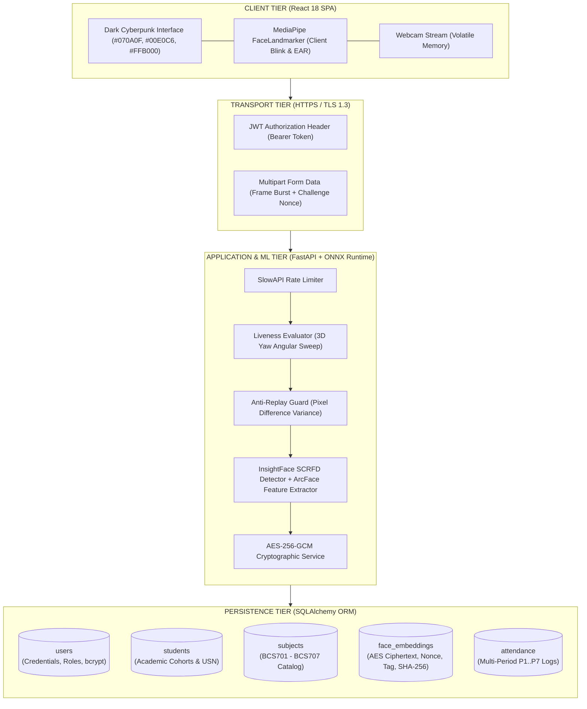
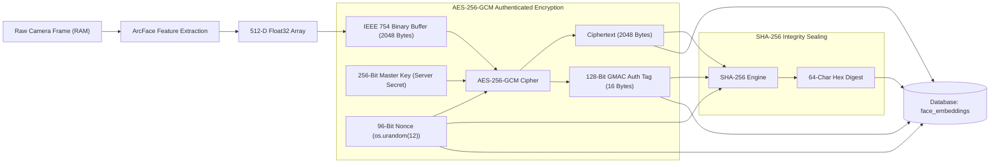
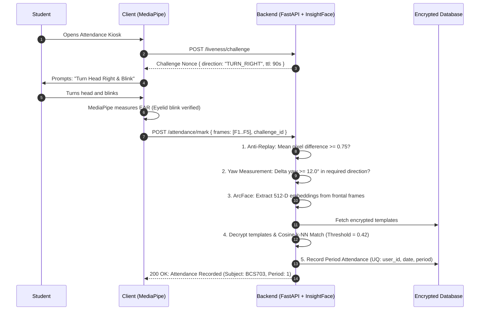
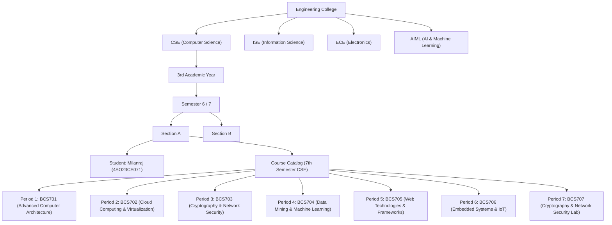
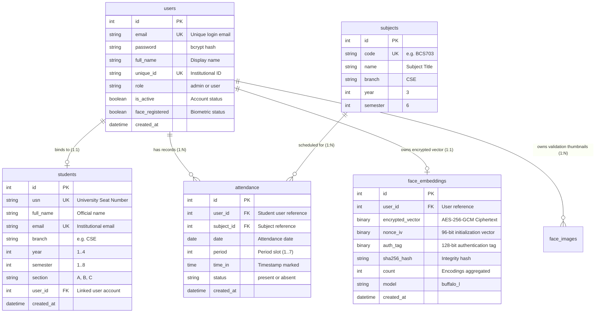
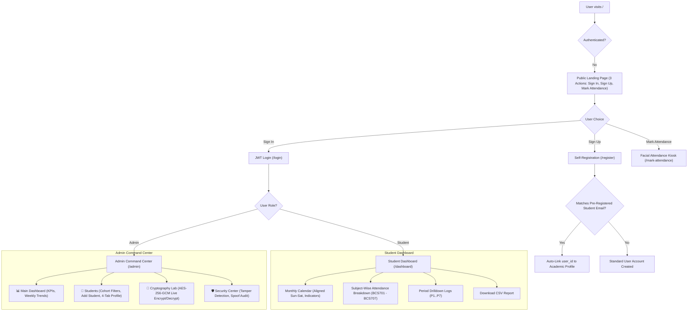

# 🔐 CipherAttend

### Cryptographically Secured AI Face Recognition Attendance & Academic Intelligence System
**Designed for VTU BCS703 Cryptography & Network Security | Academic Institution Ready**

[](https://github.com/milanraj-github/CipherAttend/actions)
[](https://python.org)
[](https://fastapi.tiangolo.com)
[](https://react.dev)
[](https://en.wikipedia.org/wiki/Galois/Counter_Mode)
[](https://en.wikipedia.org/wiki/SHA-2)
[](https://github.com/deepinsight/insightface)
[](https://developers.google.com/mediapipe)
[](https://github.com/milanraj-github/CipherAttend/actions)
[](LICENSE)

---

## 📑 Table of Contents
1. [Executive Overview](#-executive-overview)
2. [VTU BCS703 Curriculum Alignment](#-vtu-bcs703-curriculum-alignment)
3. [System Architecture & Dataflow](#-system-architecture--dataflow)
4. [Cryptographic Security & Biometric Privacy](#-cryptographic-security--biometric-privacy)
5. [AI Face Recognition & Active Anti-Spoofing Pipeline](#-ai-face-recognition--active-anti-spoofing-pipeline)
6. [College Academic Hierarchy & Multi-Period Scheduling](#-college-academic-hierarchy--multi-period-scheduling)
7. [Database Schema & Entity-Relationship Diagram](#-database-schema--entity-relationship-diagram)
8. [System Portals & User Journey Flowcharts](#-system-portals--user-journey-flowcharts)
9. [Admin Cryptography Command Center & Student Dashboard](#-admin-cryptography-command-center--student-dashboard)
10. [REST API Directory](#-rest-api-directory)
11. [Quick Start & Installation Guide](#-quick-start--installation-guide)
12. [Default Credentials & Verification](#-default-credentials--verification)

---

## 📌 Executive Overview

**CipherAttend** is an enterprise-grade academic attendance and cryptographic surveillance platform engineered to eliminate manual roll calls, proxy attendance, and biometric vulnerability. 

Traditional facial recognition platforms suffer from severe security vulnerabilities:
- They store unencrypted raw photographs or plaintext mathematical embeddings in databases.
- They are vulnerable to 2D photo print attacks, digital screen replays, and man-in-the-middle vector tampering.
- They treat attendance as a simplistic binary daily flag rather than handling institutional college timetables.

**CipherAttend resolves this through five pillars:**
1. **Zero-Raw-Image Security Architecture:** Camera frames are evaluated strictly in volatile RAM and destroyed immediately after vector extraction.
2. **Authenticated Encryption (AES-256-GCM):** Facial vector embeddings are encrypted at rest with unique 96-bit initialization vectors (IVs) and 128-bit authentication tags.
3. **Cryptographic Integrity Sealing (SHA-256):** Every record is bound to a cryptographic hash chain to detect any unauthorized database alteration.
4. **Deterministic Server-Verified 3D Liveness:** Dynamic head-turn yaw challenges issued by the server defeat photo, screen, and deepfake replay attacks.
5. **Multi-Period Academic Hierarchy:** Full cohort grouping (`Branch` ➔ `Year` ➔ `Semester` ➔ `Section` ➔ `Subjects` `BCS701`–`BCS707`) with up to **7 class periods per day**.

---

## 🔬 VTU BCS703 Curriculum Alignment

CipherAttend serves as a practical implementation and demonstration of core syllabus topics in **VTU BCS703 Cryptography & Network Security**:

| Syllabus Module | Cryptographic Concept | CipherAttend Implementation |
|---|---|---|
| **Module 1 / 2: Block Ciphers** | Advanced Encryption Standard (AES) | AES-256 operating in **Galois/Counter Mode (GCM)** for authenticated encryption of biometric vectors. |
| **Module 3: Hash Functions & MACs** | Secure Hash Algorithm (SHA-2), Message Authentication Codes | **SHA-256 digest chains** on vector records; **128-bit GMAC tags** for cipher verification. |
| **Module 4: Authentication & Key Management** | Replay Attacks, Challenge-Response, Ephemeral Nonces | Server-issued **90-second TTL randomized yaw challenges**; **96-bit cryptographically random IV nonces**. |
| **Module 5: Network Security & Privacy** | Transport Layer Security (TLS), Privacy by Design, RBAC | JWT access tokens, role-based route guards, and zero plaintext exposure of master secret keys. |

---

## 🏗️ System Architecture & Dataflow



---

## 🔐 Cryptographic Security & Biometric Privacy

### 1. Vector Encryption Pipeline (AES-256-GCM + SHA-256)



### Mathematical Foundations:
- **AES-256-GCM AEAD Function:**
  $$\text{Ciphertext}, \text{Tag} = \text{AES-GCM-Encrypt}(K_{256}, \text{IV}_{96}, \text{Plaintext}, \text{AAD})$$
- **SHA-256 Integrity Digest:**
  $$\text{Hash} = \text{SHA-256}(\text{IV}_{96} \mathbin{\Vert} \text{Tag}_{128} \mathbin{\Vert} \text{Ciphertext})$$
- **Tamper Detection Guarantee:**
  $$\text{AES-GCM-Decrypt}(K, \text{IV}, \text{Ciphertext}, \text{Tag}) = 
  \begin{cases} 
  \text{Plaintext} & \text{if Tag is Valid} \\ 
  \bot \text{ (AUTH\_FAIL)} & \text{if Modified} 
  \end{cases}$$

---

## 👁️ AI Face Recognition & Active Anti-Spoofing Pipeline

### Dynamic Challenge-Response Liveness Sequence:



---

## 🏫 College Academic Hierarchy & Multi-Period Scheduling



### Multi-Period Scheduling Rules:
- **Up to 7 Periods Per Day:** A student can attend multiple distinct periods in a single day.
- **Database Concurrency Guarantee:** The database enforces uniqueness on `(user_id, date, period)`. Duplicate submissions for the same period are rejected by database constraint, while separate periods (P1 to P7) are recorded seamlessly.
- **VTU 75% Attendance Rule:** Individual subject percentages are tracked continuously:
  $$\text{Subject Rate} = \left(\frac{\text{Periods Attended}}{\text{Total Conducted Periods}}\right) \times 100 \ge 75\%$$

---

## 🗄️ Database Schema & Entity-Relationship Diagram



---

## 🧭 System Portals & User Journey Flowcharts



---

## 🖥️ Admin Cryptography Command Center & Student Dashboard

### 1. Admin Command Center Tabs:
- 📊 **Main Dashboard:** High-level college attendance charts, security badges, and active operational stats.
- 👥 **Student Directory:**
  - Multi-tier cohort filters: Filter by Branch, Year, Semester, Section, Subject, and USN.
  - Student Table with Account Status (`Linked ✓` / `Pre-registered`) and Face Status (`Enrolled ✓` / `Pending`).
  - Comprehensive **4-Tab Student Profile Modal**:
    - `[ PROFILE ]`: Academic details, cohort breadcrumb.
    - `[ BIOMETRIC ]`: Zero raw image guarantee, vector dimension parameters.
    - `[ SECURITY ]`: Real AES-256-GCM metadata, SHA-256 verification button, server-side decrypted vector inspector.
    - `[ ATTENDANCE ]`: Subject-wise breakdown cards, period history logs, and `[ ⚡ Seed 7-Period Demo ]` button.
- 🔐 **Cryptography Lab:**
  - **Live AES-256-GCM Encryptor/Decryptor:** Interactive test sandbox allowing live encryption of vectors with randomized IV generation.
  - **SHA-256 Integrity Verifier:** Real-time hash comparison demonstrating tampering detection.
- 🛡️ **Security Center:**
  - Tamper alarm monitor, anti-spoofing rejection audit logs, and account lockouts.

### 2. Student Academic Dashboard:
- **Precision Monthly Calendar:**
  - Properly aligned to day-of-week slots (`Sun` through `Sat`).
  - Color-coded: 🟡 **Today** (Amber border), 🟢 **Present** (Teal surface with green indicator), 🔴 **Absent** (Crimson dot).
- **Subject-Wise Attendance Breakdown List:**
  - Real course metrics across all enrolled courses (`BCS701` to `BCS707`).
  - Progress bar with VTU 75% thresholds (Teal for $\ge 75\%$, Amber for $65\% - 74\%$, Red for $< 65\%$).
  - Expandable **Period Logs** revealing date, period number, timestamp, and status.

---

## 📡 REST API Directory

| Method | Endpoint | Authorization | Description |
|---|---|---|---|
| `POST` | `/auth/login` | Public | Authenticates credentials and returns JWT access token. |
| `POST` | `/auth/register` | Public | Student registration; auto-binds to academic profile. |
| `POST` | `/liveness/challenge` | Public / Token | Generates dynamic 90s head-turn challenge. |
| `POST` | `/face/register` | User Token | Enrolls face embeddings (AES-256-GCM encrypted). |
| `POST` | `/attendance/mark` | Public / Token | Verifies liveness & marks multi-period attendance. |
| `GET` | `/user/attendance` | User Token | Returns student attendance & subject breakdown. |
| `GET` | `/admin/students` | Admin Token | Cohort filterable directory of students. |
| `POST` | `/admin/students` | Admin Token | Pre-registers student academic identity. |
| `DELETE`| `/admin/students/{id}` | Admin Token | Full purge of student profile, login account & biometrics. |
| `GET` | `/admin/students/{id}/details` | Admin Token | Returns 4-tab cryptographic & attendance inspector. |
| `POST` | `/admin/students/{id}/attendance/seed-multi-period` | Admin Token | Seeds 7 distinct period records for demonstration. |
| `GET` | `/admin/academic-options` | Admin Token | Returns valid branches, years, semesters, sections. |
| `GET` | `/admin/subjects` | Admin Token | Lists all academic course subjects. |

---

## 🚀 Quick Start & Installation Guide

### Prerequisites:
- Python 3.10+ (Recommended: Python 3.11)
- Node.js 18+ & npm
- Webcam device

---

### 1. Backend Service Setup:
```bash
# Navigate to backend directory
cd backend

# Create and activate virtual environment
python -m venv .venv

# On Windows:
.venv\Scripts\activate
# On Linux/macOS:
# source .venv/bin/activate

# Install dependencies
pip install -r requirements.txt

# Start backend server
uvicorn app.main:app --reload --port 8000
```
> Interactive API Swagger Documentation: [http://localhost:8000/docs](http://localhost:8000/docs)

---

### 2. Frontend Application Setup:
```bash
# Navigate to frontend directory
cd frontend

# Install dependencies
npm install

# Start React development server
npm start
```
> Web Portal: [http://localhost:3000](http://localhost:3000)

---

### 3. One-Click Windows Launchers:
- Run `run_backend.bat` in the root folder to start FastAPI.
- Run `run_frontend.bat` in the root folder to start React.

---

## 🔑 Default Credentials & Verification

| Portal | User Type | Email | Password | Details |
|---|---|---|---|---|
| **Admin Command Center** | Administrator | `admin@gmail.com` | `admin@123` | Full access to Cryptography Lab, Student Directory & Security Center |
| **Student Dashboard** | Student (Milanraj) | `milanraj.23cs071@sode-edu.in` | `milan@123` | Pre-enrolled 7-period demo account (`USN: 4SO23CS071`) |

---

### 🧪 Automated Testing & CI Verification:
To execute the complete 77-test suite locally:
```bash
cd backend
.venv\Scripts\python -m pytest tests/ -v
```
**Result:** `77 passed in 15.96s (100% Green)`

---

<p align="center">
  Crafted with precision for <strong>Secure Biometric Intelligence & Academic Excellence</strong>
</p>
